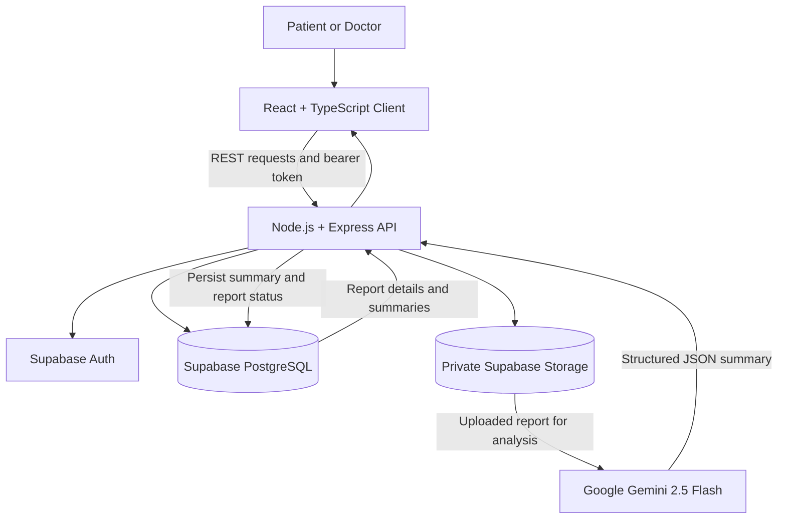

# SmartMeds AI: Medical Report Summarization

**SmartMeds AI** is a full-stack web application developed as a final-year academic project. It helps patients organize medical reports, view AI-generated summaries of report findings, and share selected records with linked doctors. Doctors can review the reports that patients share with them, view patient-specific dashboards, and add notes to shared reports.

The system uses a React and TypeScript client, a Node.js/Express REST API, Supabase for authentication, PostgreSQL data storage and private file storage, and Google Gemini for structured report analysis.

> **Medical and privacy notice:** SmartMeds AI is an academic project and is not a diagnostic system or a substitute for a qualified healthcare professional. AI-generated summaries can be incomplete or inaccurate and must be checked against the original report. Do not use real patient data in demos or development without appropriate consent, authorization, and safeguards. Uploaded report content is processed by the configured AI provider.

---

## Table of Contents

- [Project Overview](#project-overview)
- [Objectives](#objectives)
- [Features](#features)
- [Technology Stack](#technology-stack)
- [System Architecture](#system-architecture)
- [Repository Structure](#repository-structure)
- [Prerequisites](#prerequisites)
- [Setup and Installation](#setup-and-installation)
- [Environment Variables](#environment-variables)
- [Database and Storage Setup](#database-and-storage-setup)
- [Running the Application](#running-the-application)
- [API Overview](#api-overview)
- [Data Model](#data-model)
- [Project Documentation](#project-documentation)
- [Security and Privacy Considerations](#security-and-privacy-considerations)
- [Limitations and Future Enhancements](#limitations-and-future-enhancements)
- [License](#license)

## Project Overview

Medical information is often spread across laboratory reports, prescriptions, scan reports, and discharge summaries. Reading each document and tracking changes over time can be difficult for patients and their healthcare providers.

SmartMeds AI provides one workspace for uploading and organizing medical documents, extracting their key information with an AI model, highlighting potentially abnormal findings, and sharing selected records with linked doctors. It includes separate patient and doctor experiences so that each role sees the features relevant to its workflow.

### Objectives

- Make medical reports easier to review through structured, plain-language summaries.
- Organize uploaded reports in a searchable and paginated history.
- Highlight reported abnormal findings and tests marked as pending.
- Allow patients to build a basic health profile and manage doctor connections.
- Enable patients to explicitly share and revoke access to individual reports.
- Give doctors a consolidated view of linked patients and the records shared with them.
- Provide a foundation for exploring AI-assisted health-information management in an academic setting.

## Features

### Patient workspace

- **Account creation and sign-in:** Register and sign in using an email address and password, with the account managed by Supabase Auth.
- **Patient onboarding and health profile:** Store profile information such as date of birth, biological sex, blood group, height, weight, known conditions, current medications, allergies, and emergency-contact details.
- **Medical report upload:** Upload PDF, JPEG, and PNG files up to **10 MB per file**.
- **Report organization:** Add a display name and report type, browse report history, search by name, view processing status, replace a report, or delete a report.
- **Patient dashboard:** View report-related metrics, including reports analyzed, linked doctors, and critical flags where available.
- **AI-generated report summaries:** Review extracted report details, a plain-language summary, categorized findings, values and reference ranges when present, critical flags, pending results, report status, and recommendations found in the source report.
- **Overall summary:** Generate a consolidated AI summary from available report summaries and the patient profile.
- **Doctor directory and connections:** Search for doctors, link or unlink a doctor, and manage clinical relationships.
- **Report sharing controls:** Share specific reports with linked doctors and revoke access later.
- **Report notes:** View notes associated with reports where available.

### Doctor workspace

- **Doctor profile:** Maintain a professional profile with a medical specialty and biography.
- **Doctor dashboard:** View an overview of linked patients, shared records, and critical flags from available report analyses.
- **Patient directory:** Browse and search patients linked to the doctor.
- **Shared record access:** Open only reports that have been shared with the doctor through the application's sharing workflow.
- **Report analysis view:** Review the AI summary, findings, pending results, and critical flags for a shared report.
- **Patient overview:** Review information and shared reports for a linked patient, including an overall summary when available.
- **Clinical notes:** Add a note to a report when the doctor has access to that report.

### AI-assisted analysis

The backend uses **Google Gemini 2.5 Flash** to analyze uploaded documents and request structured JSON output. The report-analysis schema includes:

- Report type, patient name, and report date when identifiable.
- A short plain-language summary.
- Critical flags, including the reported metric, value, unit, status, and explanatory note where available.
- Findings grouped into categories, with metric names, values, units, reference ranges, and abnormality indicators when available.
- Report status and tests marked as pending.
- Follow-up or doctor recommendations extracted from the source report.

A separate overall-summary workflow combines available report summaries and profile information to produce a broader overview, including an overall status and active clinical concerns. Results depend on the quality and legibility of the uploaded document and must be independently verified.

### User experience

- Separate patient and doctor navigation and dashboards.
- Responsive layouts for different screen sizes.
- Dark-mode styling.
- Form validation using React Hook Form and Zod.
- Client-side query caching and refresh after data-changing operations.
- Loading states, empty states, and toast notifications.
- Session renewal handling through the API client when refresh credentials are available.

## Technology Stack

| Layer | Technologies |
|---|---|
| Frontend | React 19, TypeScript, Vite |
| Routing | React Router 7 |
| Server-state and caching | TanStack React Query 5 |
| HTTP client | Axios |
| Forms and validation | React Hook Form, Zod |
| File selection | React Dropzone |
| Styling | Tailwind CSS 4 |
| Notifications and icons | Sonner, Lucide React |
| Backend | Node.js, Express 4, JavaScript ES modules |
| Authentication | Supabase Auth with access and refresh tokens |
| Database | Supabase PostgreSQL |
| File storage | Supabase Storage, using the private `medical-docs` bucket |
| AI analysis | Google Gemini 2.5 Flash through `@google/genai` |
| Upload handling | Multer with in-memory file handling and a 10 MB limit |
| Backend validation/configuration | Zod, dotenv |

## System Architecture



### High-level workflow

1. A patient creates an account and completes the relevant profile fields.
2. The patient uploads a PDF, JPEG, or PNG report through the client.
3. The API validates the upload, stores the file in the private Supabase Storage bucket, and creates report metadata in the database.
4. The backend sends the stored document to Gemini for analysis and saves the structured result in the `summaries` table.
5. The client retrieves and displays the report summary and relevant findings.
6. The patient can link a doctor and explicitly share selected reports. The doctor can then review permitted records and add notes.

## Repository Structure

```text
Smartmeds/
├── Medical_Report_Summarization-Client/
│   ├── public/                 # Static assets
│   ├── src/
│   │   ├── components/         # Reusable UI components
│   │   ├── context/            # Authentication context
│   │   ├── hooks/              # Query and application hooks
│   │   ├── lib/                # API client and utilities
│   │   ├── pages/              # Patient, doctor, auth, and shared pages
│   │   ├── services/           # Frontend service functions
│   │   └── types/              # TypeScript types
│   ├── FRONTEND_DOCS.md        # Frontend workflows and features
│   ├── API_DOCS.md             # API integration reference copy
│   └── package.json
│
├── Medical_Report_Summarization-Api/
│   ├── scripts/
│   │   ├── setup_supabase.sql  # Fresh Supabase database/storage setup
│   │   ├── add_report_notes.sql
│   │   ├── database.sql        # Initial schema script
│   │   └── migrate_to_reports.sql
│   ├── src/
│   │   ├── config/             # Supabase configuration
│   │   ├── controllers/        # HTTP request handlers
│   │   ├── middleware/         # Authentication and error handling
│   │   ├── routes/             # REST API routes
│   │   ├── services/           # Database, report, and Gemini logic
│   │   ├── utils/              # Shared API utilities
│   │   └── validators/         # Request validation schemas
│   ├── API_DOCS.md             # API endpoint documentation
│   └── package.json
│
└── README.md
```

## Prerequisites

Install or prepare the following before running the application:

- **Node.js and npm:** Use a current Node.js LTS release compatible with the installed Vite version.
- **Supabase project:** The application uses Supabase Auth, PostgreSQL, and Storage.
- **Google Gemini API key:** Required for AI-based report and overall-summary generation.
- **Git:** Optional for local setup, but recommended for version control.

## Setup and Installation

The frontend and backend run as separate applications. Start both during local development.

### 1. Get the source code

Clone the repository or download it from GitHub. From the repository root, you should see both the `Medical_Report_Summarization-Client` and `Medical_Report_Summarization-Api` folders.

### 2. Configure Supabase

1. Create a Supabase project.
2. Open the SQL Editor in the Supabase dashboard.
3. Run the SQL scripts described in [Database and Storage Setup](#database-and-storage-setup).
4. Copy the project URL and the server-side service-role key from the Supabase project settings. Keep the service-role key private.

### 3. Configure and start the backend

Open a terminal in the repository root and run:

```bash
cd Medical_Report_Summarization-Api
npm install
```

Create a local `.env` file by copying `.env.example`.

**Windows PowerShell:**

```powershell
Copy-Item .env.example .env
```

**macOS/Linux:**

```bash
cp .env.example .env
```

Edit `Medical_Report_Summarization-Api/.env` and set the values listed in [Environment Variables](#environment-variables). Then start the API:

```bash
npm run dev
```

The backend defaults to port `5000`. A successful startup should log that the SmartMeds API is running on the configured port. The server also performs a lightweight Supabase connection check during startup.

### 4. Configure and start the frontend

Open a **second terminal** from the repository root:

```bash
cd Medical_Report_Summarization-Client
npm install
```

Create `Medical_Report_Summarization-Client/.env` with the following local API URL:

```env
VITE_API_BASE_URL=http://localhost:5000/api
```

Start the frontend development server:

```bash
npm run dev
```

Vite will print the local URL in the terminal, typically `http://localhost:5173`. Open the printed URL in a browser.

### 5. Build and lint the frontend

From `Medical_Report_Summarization-Client`:

```bash
npm run build
npm run lint
```

The backend scripts are:

```bash
npm run dev     # Start with nodemon
npm start       # Start with Node.js
```

## Environment Variables

### Backend: `Medical_Report_Summarization-Api/.env`

| Variable | Purpose |
|---|---|
| `PORT` | API listening port; defaults to `5000` if not set. |
| `SUPABASE_URL` | URL of the Supabase project. |
| `SUPABASE_SERVICE_KEY` | Supabase server-side service-role key used by the API. Treat this as a high-privilege secret. |
| `GEMINI_API_KEY` | API key used by the Google Gemini service. |

Example format only; replace the placeholders with your own credentials:

```env
PORT=5000
SUPABASE_URL=https://YOUR_PROJECT_REF.supabase.co
SUPABASE_SERVICE_KEY=YOUR_SUPABASE_SERVICE_ROLE_KEY
GEMINI_API_KEY=YOUR_GEMINI_API_KEY
```

### Frontend: `Medical_Report_Summarization-Client/.env`

| Variable | Purpose |
|---|---|
| `VITE_API_BASE_URL` | Base URL of the backend API, including `/api`. For local development, use `http://localhost:5000/api`. |

Vite exposes `VITE_*` variables to the browser bundle. **Never put a service-role key, Gemini key, database password, or other secret in the frontend environment.**

## Database and Storage Setup

For a fresh Supabase project, use the SQL Editor and run these scripts in order:

1. `Medical_Report_Summarization-Api/scripts/setup_supabase.sql`
2. `Medical_Report_Summarization-Api/scripts/add_report_notes.sql`

The setup script creates the main application tables, indexes, the private `medical-docs` storage bucket, and related storage policies. The separate notes script creates the table used for doctor notes. Review the SQL and your Supabase project's policies before using real data.

Other scripts are included for reference or migration scenarios:

- `database.sql`: initial database setup script.
- `migrate_to_reports.sql`: migration for an older schema that used the `documents` table. Do not run a migration script on a fresh database unless its prerequisites match your existing schema.

## API Overview

The API base path is `/api`. Protected endpoints require an access token in the header:

```http
Authorization: Bearer <access_token>
```

The API returns JSON responses. Detailed request bodies, query parameters, response examples, and authentication notes are documented in [`Medical_Report_Summarization-Api/API_DOCS.md`](./Medical_Report_Summarization-Api/API_DOCS.md).

| Area | Endpoint | Purpose |
|---|---|---|
| Authentication | `POST /api/auth/signup` | Register an account. |
| Authentication | `POST /api/auth/login` | Sign in. |
| Authentication | `POST /api/auth/refresh` | Refresh an access token. |
| Authentication | `POST /api/auth/logout` | Sign out. |
| Authentication | `GET /api/auth/me` | Get the current user's profile. |
| Reports | `POST /api/reports/upload` | Upload a report and start analysis. |
| Reports | `GET /api/reports` | List the user's reports, with pagination and optional name filtering. |
| Reports | `GET /api/reports/dashboard` | Retrieve patient dashboard metrics. |
| Reports | `GET /api/reports/:id` | Retrieve a report and associated details. |
| Reports | `PUT /api/reports/:id` | Replace an existing report and trigger reprocessing. |
| Reports | `DELETE /api/reports/:id` | Delete a report. |
| Report notes | `POST /api/reports/:reportId/notes` | Add a note to a report when the doctor has access. |
| Summaries | `GET /api/summary/:reportId` | Retrieve one report's AI summary. |
| Summaries | `GET /api/summary/overall` | Retrieve the signed-in patient's overall summary. |
| Summaries | `GET /api/summary/overall/:patientId` | Retrieve an overall summary for an authorized linked patient. |
| Profiles | `GET /api/profile/medical` | Retrieve the signed-in user's medical profile. |
| Profiles | `PUT /api/profile/medical` | Update medical profile fields. |
| Profiles | `PUT /api/profile/doctor` | Update the doctor's professional profile. |
| Doctors | `GET /api/doctor/search` | Search the doctor directory. |
| Doctors | `GET /api/doctor/my-doctors` | List doctors linked to the patient. |
| Doctors | `POST /api/doctor/link/:doctorId` | Link a doctor. |
| Doctors | `DELETE /api/doctor/unlink/:doctorId` | Unlink a doctor and remove related report shares. |
| Doctors | `GET /api/doctor/dashboard` | Retrieve doctor dashboard metrics. |
| Doctors | `GET /api/doctor/patients` | List linked patients. |
| Doctors | `GET /api/doctor/patients/:patientId/reports` | List reports shared by a linked patient. |
| Sharing | `POST /api/shares/:reportId` | Share a report with a linked doctor. |
| Sharing | `DELETE /api/shares/:reportId` | Revoke a report share. |
| Sharing | `GET /api/shares` | List the patient's report shares. |
| Sharing | `GET /api/shares/doctor/:doctorId` | List reports shared with a specified doctor. |

## Data Model

The primary database entities are:

- **`profiles`**: application profiles and patient/doctor details, associated with Supabase Auth users.
- **`reports`**: uploaded report metadata, owner, file path, MIME type, report type/name, and processing status.
- **`summaries`**: structured AI summary JSON stored for a report.
- **`doctor_patient`**: links between patients and doctors.
- **`report_shares`**: explicit report-to-doctor sharing records.
- **`report_notes`**: notes entered by doctors for reports they can access.

Original report files are stored in the private Supabase Storage bucket named `medical-docs`; the database stores the associated file path and metadata.

## Project Documentation

- [Frontend feature and workflow documentation](./Medical_Report_Summarization-Client/FRONTEND_DOCS.md)
- [Backend API documentation](./Medical_Report_Summarization-Api/API_DOCS.md)
- [Supabase setup script](./Medical_Report_Summarization-Api/scripts/setup_supabase.sql)

## Security and Privacy Considerations

- Do not commit `.env` files, API keys, Supabase service-role credentials, database passwords, tokens, or patient documents.
- The backend `SUPABASE_SERVICE_KEY` is a privileged server-side credential. It must never be placed in the frontend or exposed in a browser bundle.
- Keep `.env.example` limited to variable names and safe placeholders.
- The current Express application enables CORS without an origin allowlist. Restrict allowed origins before any public deployment.
- Review Supabase database and Storage policies, access-control checks, logging, error handling, and key rotation procedures before handling sensitive information.
- Medical reports may contain personal and highly sensitive information. Use synthetic or properly de-identified files for demonstrations and academic testing.
- AI results may omit or misinterpret content, especially in low-quality scans or complex reports. Always verify findings against the original document.
- This repository does not claim HIPAA compliance, regulatory approval, or clinical validation.

## Limitations and Future Enhancements

Potential future work for the project includes:

- Automated tests for API routes, access-control rules, and key frontend workflows.
- More robust validation and error reporting for scanned, rotated, or low-quality documents.
- Clinician review workflows with explicit review states and audit history.
- Rate limiting, structured logging, monitoring, and stricter production CORS configuration.
- Improved deployment configuration and CI checks for the client and API.
- Additional privacy, security, accessibility, and clinical-safety evaluation.

## License

No license has been specified in this repository. Unless a license is added, permission to reuse, modify, or redistribute this code should not be assumed.
